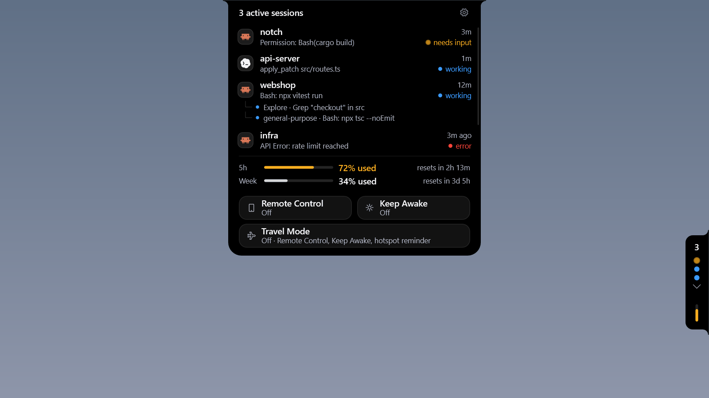
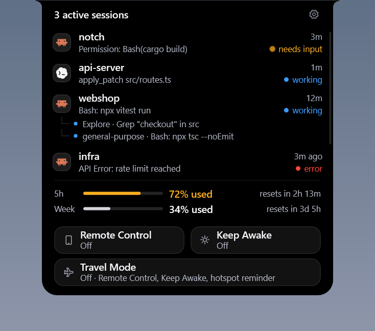
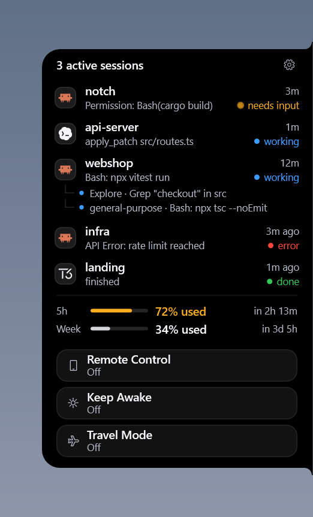
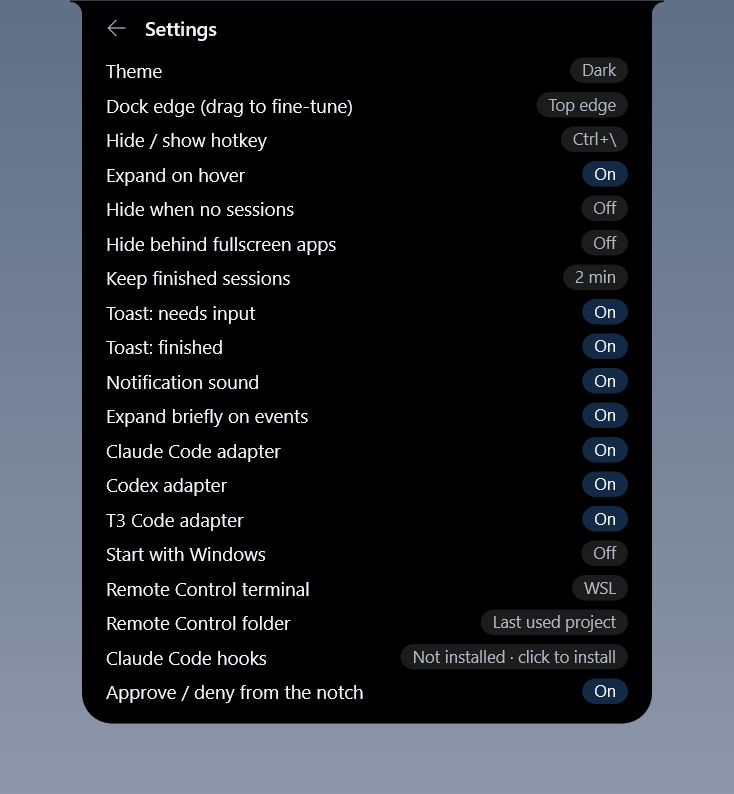

# Notch

**A tiny Mac-style notch for Windows that shows your AI coding agents at a glance.**

Notch sits flush against a screen edge, opens when you hover it, and tells you which
sessions are working, which are waiting on you, and which have finished. It follows Claude
Code (terminal and desktop app), Codex and T3 Code, shows your usage limits, and lets you
approve a permission request without switching windows.

Native Rust and Direct2D. One self-contained exe of about 1 MB. No installer, no runtime,
no telemetry.

[**Website**](https://agentnotch-six.vercel.app) · [**Download for Windows**](https://github.com/harshil12345000/AgentNotch/releases/latest/download/notch.exe) · [Releases](https://github.com/harshil12345000/AgentNotch/releases)



> Screenshots are rendered by Notch itself from demo data (`notch.exe --snapshot`).

## Contents

- [What it does](#what-it-does)
- [Screenshots](#screenshots)
- [Install](#install)
- [Using it](#using-it)
- [How sessions are tracked](#how-sessions-are-tracked)
- [Claude Code hooks](#claude-code-hooks)
- [Approve or deny from the notch](#approve-or-deny-from-the-notch)
- [Codex, T3 Code and WSL](#codex-t3-code-and-wsl)
- [Usage limits](#usage-limits)
- [Remote Control, Keep Awake, Travel Mode](#remote-control-keep-awake-travel-mode)
- [Performance](#performance)
- [Command line](#command-line)
- [Build from source](#build-from-source)
- [What is and is not verified](#what-is-and-is-not-verified)
- [Credits](#credits)

## What it does

| | |
|---|---|
| **Live sessions** | Every open Claude Code session, with its real title, current step and elapsed time. Codex and T3 Code sessions too. |
| **Status at a glance** | Blue = working (steady). Amber = needs you. Green = finished. Red = error. The ones that want you pulse. |
| **Subagents** | Every subagent running inside a session is listed under it, with what it is doing. |
| **Approve / Deny** | Answer a permission request from the notch or from the toast. |
| **Jump to the session** | Click a row to open exactly that session in the Claude desktop app, or raise its terminal. |
| **Usage limits** | Your 5-hour and weekly Claude usage as percentages, with time to reset. |
| **Remote Control** | Start or stop Claude Code Remote Control in one click. |
| **Keep Awake** | Close the lid and keep working on an external monitor. Stays on until you switch it off. |
| **Travel Mode** | Keep Awake + Remote Control + a full-screen "Turn On Mobile Hotspot" reminder, in one click. |
| **Docks anywhere** | Drag it to any point on the top, bottom, left or right edge of any monitor, or let it float. |
| **Stays out of the way** | Hides behind fullscreen apps, and on a hotkey (Ctrl+\\ by default). |

## Screenshots

**Collapsed.** A count, one dot per session, and a small usage bar.


**Open.** Hover to open it. Sessions with their subagents, usage limits, and the toggles.



**On a side edge.** A vertical tab that opens into a narrower, taller panel.

 

**Settings.** Drawn natively, like everything else.



## Install

Requires Windows 10 or 11 (64-bit).

1. Download [`notch.exe`](https://github.com/harshil12345000/AgentNotch/releases/latest/download/notch.exe).
2. Run it from a terminal with `--install`:

   ```
   notch.exe --install
   ```

   This copies it to `%LOCALAPPDATA%\Programs\Notch`, adds a **Notch** shortcut to the
   Desktop and the Start Menu, and starts it. It needs no administrator rights.
3. When it asks, let it install the Claude Code hooks (see [below](#claude-code-hooks)).

You can also just double-click `notch.exe` to try it without installing anything.

The exe is not code-signed, so Windows SmartScreen may warn the first time: choose
**More info**, then **Run anyway**. If you would rather not trust a download, [build it
from source](#build-from-source).

**Taskbar.** Windows does not let an app pin itself. Right-click the Notch shortcut and
choose **Pin to taskbar**. Notch has no taskbar window of its own; clicking the pinned icon
while it is running shows the notch and opens it.

**Remove.** `notch.exe --uninstall-hooks`, then `notch.exe --uninstall`, then delete
`%LOCALAPPDATA%\Programs\Notch` and `%APPDATA%\Notch`.

**macOS.** There is no Mac version. Notch is written against the Windows graphics and
window APIs.

## Using it

- **Hover** the notch to open it; move away and it closes. Clicking the header closes it
  at once.
- **Drag** it to any screen edge, anywhere along the edge. It attaches when its centre
  comes within 56 px of an edge. On the bottom edge it sits on top of the taskbar and
  opens upward. Dropped away from the edges it floats as a pill. The position is
  remembered per monitor setup.
- **Ctrl+\\** hides and shows it. Change the keys in Settings: click the row and press the
  new combination (Backspace clears it, Esc cancels).
- **Click a session** to go to it. Hover a row and press the **x** to dismiss it.
- **Tray icon:** Show/Hide, Clear finished sessions, Travel mode, Settings, Start with
  Windows, Quit.

Every open Claude Code session stays listed, working or idle, for as long as its process
lives. Finished sessions from other agents leave after 2 minutes (Settings: "Keep finished
sessions").

Config lives in `%APPDATA%\Notch\config.toml`, logs in `%LOCALAPPDATA%\Notch\logs` (two
files of at most 2 MB). Nothing leaves your machine except the usage request described
under [Usage limits](#usage-limits).

## How sessions are tracked

Three sources, most trusted first:

1. **Claude Code's registry of open sessions**, `~/.claude/sessions/<pid>.json`. Claude
   Code keeps one file per running session with its process id, title, folder and a live
   status it rewrites on every change: `busy`, `idle`, or `waiting` with what it is
   waiting for. This decides which sessions exist, their titles, and when one is waiting
   on you. It needs no hooks.
2. **Hooks:** the current step, permission requests you can answer, and the question a
   turn ended with.
3. **Transcripts**, `~/.claude/projects/<project>/<session>.jsonl` and its `subagents`
   folder: the current step for sessions without hooks, the end of a turn (a second
   witness if a hook is missed), and every running subagent.

Notch reads only what was appended to a file since it last looked, and is driven by file
change notifications rather than polling.

These file layouts are internal to Claude Code and can change with an update. Each source
is read defensively and independently, so if one stops making sense the others carry on.
Checked against Claude Code 2.1.319 and 2.1.325.

## Claude Code hooks

Hooks make sessions update the instant something happens. Install them when Notch first
asks, from Settings > "Claude Code hooks", or with `notch.exe --install-hooks`.

What this does to `~/.claude/settings.json`:

- Saves a copy first as `settings.json.notch-backup`.
- Appends one entry per event **after** your existing hooks. Nothing of yours is changed,
  removed or reordered. Events: SessionStart, UserPromptSubmit, PreToolUse, PostToolUse,
  PostToolUseFailure, PermissionRequest, Notification, Stop, StopFailure, SubagentStart,
  SubagentStop, PreCompact, SessionEnd.
- Each entry runs `notch.exe --hook` with `"async": true`, so Claude Code never waits for
  it. The helper forwards the hook's JSON over a local named pipe (`\\.\pipe\notch`) and
  exits. If Notch is not running it exits immediately. The one exception is
  PermissionRequest, which waits so it can carry your answer back (next section).

Uninstalling (`notch.exe --uninstall-hooks`, or Settings) restores the file byte for byte
from the backup if you changed nothing else in the meantime; otherwise only Notch's entries
are removed.

The hooks store the path of the exe: if you move it, run `--install-hooks` again. Sessions
that were already running when you installed the hooks pick them up when they are next
started.

## Approve or deny from the notch

When a session asks for permission, its row shows **Approve** and **Deny**, and so does
the toast. Your click is passed back to Claude Code as the hook's decision. Deny rules in
your Claude settings still win over an Approve.

- Offered for sessions hosted by the Claude desktop app or an SDK app. There the hook runs
  alongside the host's own prompt and whichever is answered first applies, so you can
  still answer in Claude as usual.
- Not offered for terminal sessions by default, because it is not documented whether
  Claude Code shows its own prompt while a hook is still deciding. Set
  `approve_in_terminal = true` in the config to try it.
- If you answer in Claude instead, Notch releases the hook and the buttons disappear.
- Settings > "Approve / deny from the notch" switches the feature off.

## Codex, T3 Code and WSL

**Codex.** `notch.exe --install-hooks --codex` adds entries to `~/.codex/hooks.json` next
to any hooks already there (same merge, backup and byte-exact uninstall). Codex then asks
you to review and trust them (`/hooks`). Rollout files under `~/.codex/sessions` are
followed as a fallback, but they do not record approval requests, and Codex builds that
keep sessions in a database write none.

**T3 Code** has no hooks. Notch reads its state database
(`~/.t3/userdata/statev2.sqlite`) read-only, through the SQLite that ships with Windows,
each time it changes. Each thread's latest run becomes a session. Individual tool calls
inside a run are not shown.

**WSL.** Start the distro, then `notch.exe --install-hooks --wsl <distro>`. The hook runs
the Windows exe through WSL interop. Notch never boots a distro itself. Set
`[wsl] enabled = true` to read running WSL sessions at startup.

Gemini CLI, Cursor agent and OpenCode are stubs: see [Adding an adapter](#adding-an-adapter).

## Usage limits

Notch shows the same figures as Claude Code's `/usage`: percent used for the 5-hour and
weekly windows, and the time until each resets. Under 60% is neutral, 60 to 90% amber,
over 90% red.

- The numbers come from `https://api.anthropic.com/api/oauth/usage`, using the sign-in
  Claude Code keeps in `~/.claude/.credentials.json`. Notch only reads that file. The
  token is sent only to api.anthropic.com and is never logged, stored or shown.
- If that sign-in has expired, Notch does not refresh it itself. It runs
  `claude auth status` in the background, at most once every 20 minutes, so that Claude
  Code renews its own file.
- The endpoint is undocumented and rate-limits readily. Notch asks at most every 5 minutes
  (and when you open the panel, at most once a minute), never while the PC is locked or
  idle, and keeps the last real numbers on screen with their age rather than replace them
  with an error.

## Remote Control, Keep Awake, Travel Mode

**Remote Control** opens a terminal tab in a project folder and runs
`claude remote-control`, so you can continue a session from your phone or the web. Click
again to stop it. It shows "On, already running" when Remote Control is active without
Notch having started it (for example the desktop app's "Connect new sessions to Remote
Control"); Notch cannot stop those.

**Keep Awake** sets "when I close the lid: do nothing" for both plugged in and battery, and
holds the system and display awake. The previous values are saved first. Once on it stays
on across restarts until you switch it off, which puts both sides back (a side that was
already "do nothing" goes to sleep, the Windows default). The laptop's own screen still
turns off with the lid closed; the PC and any external monitor keep running.

**Travel Mode** switches Keep Awake on, starts Remote Control if it is not running, and
covers the screen with a "Turn On Mobile Hotspot" reminder until you dismiss it. Click it
again to switch both off.

## Performance

Measured on Windows 11, 12 logical cores, 150% scaling. CPU is the share of the whole
machine, as Task Manager shows it.

| Case | CPU avg | CPU peak | Working set |
|---|---|---|---|
| Idle, no sessions, 60 s (first milestone build) | 0.002% | 0.13% | 24.4 MB |
| 5 demo sessions, 3 dots pulsing, collapsed | 0.22% | 0.78% | 28 MB peak, 12 MB after trim |
| 5 demo sessions, 3 dots pulsing, open | 0.38% | 0.95% | 32 MB peak, 13 MB after trim |
| 5 sessions, about 80 hook events per second, open | 1.85% | 4.23% | 41 MB peak |

The hook helper returns in about 10 ms (median; 13.5 ms at the 95th percentile).

How it stays light: no web view, a software Direct2D target instead of a GPU device,
redraws only when something changes, a pulse that repaints just the dots, timers that stop
when there is nothing to animate, and graphics libraries that are not even loaded when the
exe runs as a hook helper.

Run it yourself with `notch.exe --bench` (60 seconds, one line a second, written to
`%LOCALAPPDATA%\Notch\logs\bench.log`).

## Command line

```
notch.exe                       start
notch.exe --install             install to %LOCALAPPDATA%\Programs\Notch with shortcuts, and start
notch.exe --uninstall           remove the shortcuts and the Start-with-Windows entry
notch.exe --status              what Notch detects: sessions, hooks, lid action, Remote Control
notch.exe --quit                ask the running notch to exit
notch.exe --install-hooks       add the hooks              [--codex] [--wsl <distro>] [--settings <file>]
notch.exe --uninstall-hooks     remove them
notch.exe --decide <session> allow|deny     answer a pending permission request
notch.exe --bench [secs]        log working set and CPU every second     [--expanded] [--demo]
notch.exe --snapshot f.bmp      render the UI with demo data             [--expanded] [--settings] [--edge top|bottom|left|right]
```

Set `NOTCH_INSTANCE=name` to run a second, isolated notch next to the real one for testing.

## Build from source

Needs the Rust toolchain (MSVC) and the Windows SDK.

```
git clone https://github.com/harshil12345000/AgentNotch
cd AgentNotch
cargo build --release
cargo test --release
target\release\notch.exe --install
```

### Adding an adapter

1. Add `src/adapters/<name>.rs` with a type implementing `AgentAdapter`
   (`src/adapters/mod.rs`): `id`, `agent`, `enabled`, and either or both of
   `on_push` (translate one pushed JSON payload into events) and `start` (spawn a thread
   that watches files and posts events; `watch::watch_dir` and `watch::Tailer` do the file
   work).
2. Register it in `REGISTRY` in `src/adapters/mod.rs`.
3. If the agent can run a program on events, point it at `notch.exe --hook --agent <id>`.

Every event carries a session id, agent, project folder, optional title and process ids,
and one of: `SessionStarted`, `Working{step}`, `NeedsInput{reason}`, `Done`, `Error`,
`SessionEnded`.

## What is and is not verified

Checked on the development machine:

- The performance figures above. The idle row predates most features and has not been
  re-run on the current build.
- Hook install then uninstall on copies of a real `~/.claude/settings.json` and
  `~/.codex/hooks.json`: byte-identical afterwards, existing hooks stayed first.
- Live: open desktop-app sessions listed with their real titles, their running subagents
  under them, real usage percentages, and Keep Awake surviving a quit and restart.
- Approve / Deny end to end against a simulated blocking hook, which received exactly the
  allow and deny responses Claude Code documents.
- 42 unit tests.

Not verified:

- Approve / Deny on a real permission prompt, and a real toast being clicked.
- That the desktop app switches to a different session when its link is opened (Windows
  accepts the link).
- The Remote Control and Travel Mode buttons being pressed.
- Dragging between edges, the hotkey, multi-monitor and mixed-DPI behaviour by hand.
- The T3 Code and Codex adapters against a live session, and anything in WSL.
- Fullscreen auto-hide reacts to foreground changes; a window that goes fullscreen
  without one (F11) is noticed only at the next change.

## Credits

- [DM Sans](https://github.com/googlefonts/dm-fonts) (SIL Open Font License 1.1), embedded:
  see `assets/DMSans-OFL.txt`.
- Agent logos from [thesvg.org](https://thesvg.org), in `assets/logos`. The marks belong
  to their owners and are used only to identify each agent.

Notch is an independent project and is not affiliated with Anthropic, OpenAI or T3.
